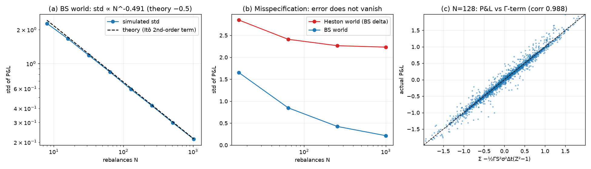
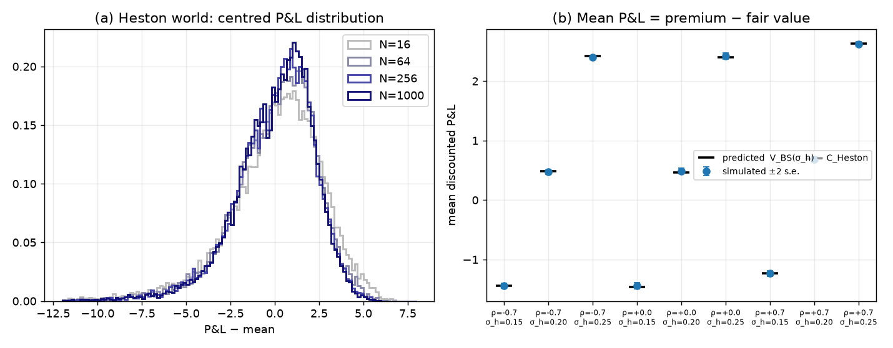
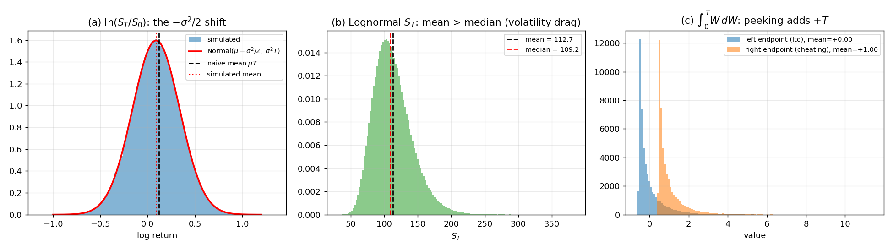
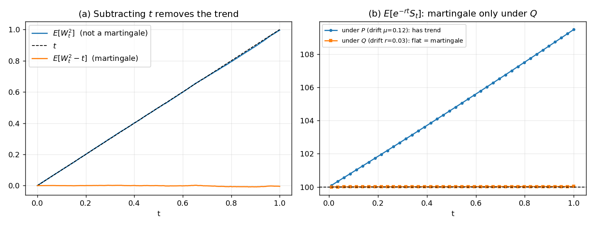
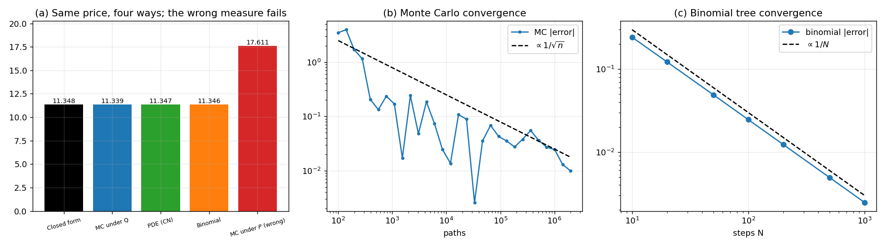
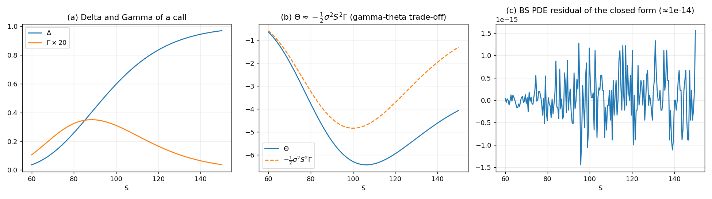
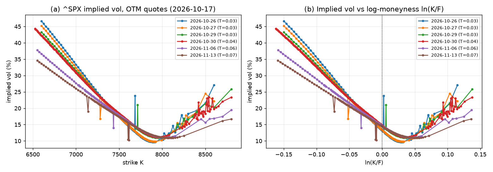
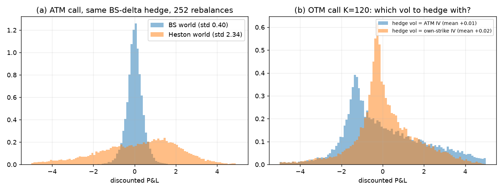

# Where Does Delta-Hedging Error Come From?
### Itô calculus, martingales and Black-Scholes, tested against stochastic volatility

## Research question

> A trader sells an option and hedges it with the Black-Scholes delta. The hedge leaves a residual profit-and-loss (P&L).
> **How much of that residual comes from (i) hedging only at discrete times, and how much from (ii) the model being wrong? Can each part be predicted in advance?**

Method: derive the prediction on paper ([`docs/derivations.md`](docs/derivations.md)), then test it by simulation, in a world where Black-Scholes holds exactly (error = pure discretisation) and in a Heston stochastic-volatility world (error = discretisation + misspecification). Everything is covered by an automated test suite (35 tests).

## Key findings

1. **In a true Black-Scholes world the hedge error is exactly the second-order Itô term and is predictable.** Each step leaves $`-\frac{1}{2}\Gamma S^2 \sigma^2 \Delta t\,(Z^2 - 1)`$. Summing its variance gives a closed-form prediction for the std of the P&L, which matches simulation to within **7%** at N=8 and **3%** for every N ≥ 32. The summed $\Gamma$-terms correlate with the actual P&L at **0.957 (N=8) rising to 0.996 (N=1024)**. The std falls like $N^{-0.491}$ (theory $-0.5$).
2. **Under Heston, hedging more often does not help.** From N=16 to N=1000 rebalances the std only falls from 2.85 to 2.23, while in the BS world it falls from 1.65 to 0.22 (a **10×** gap at N=1000). The distribution is also left-skewed (skew ≈ −1.0) with fat tails (1% quantile −7.2 vs −0.56). The floor is model risk, not discretisation.
3. **The *mean* P&L under misspecification is fixed by the premium and is predictable to within sampling error.** If you sell at $`V_{\mathrm{BS}}(\sigma_h)`$ and the true model is Heston, $`\mathbb{E}[\text{P\&L}] = V_{\mathrm{BS}}(\sigma_h) - C_{\mathrm{Heston}}`$. Across 9 settings (3 correlations × 3 hedge vols) the largest deviation from the prediction is **1.2 standard errors**.
4. **A correct average does not mean a safe hedge:** the premium decides the mean, but the spread and the left tail stay large whatever hedge vol is chosen.

**Base parameters:** `S0=K=100, T=1, r=3%`; BS-world $\sigma = 20\%$; Heston `v0=θ=0.04, κ=2, ξ=0.5, ρ=−0.7` (so long-run vol = 20% = the BS $\sigma$). Seeds are fixed.

## Reproduce

```bash
pip install -r requirements.txt
pytest -q                  # 35 tests, ~5 s
python run_research.py     # Section A  -> figures/fig8–9, results_research.json
python run_all.py          # Section B  -> figures/fig1–5, results.json
python datapull.py         # Section C1 data -> data/quotes_SPX_REAL.csv (needs network)
python run_extension.py    # Section C  -> figures/fig6–7, results_extension.json
```

Layout: `src/itobs/` (`bs`, `ito`, `martingale`, `pricing`, `hedging`, `heston`, `implied_vol`, `theory`), `tests/`, `docs/derivations.md`, `data/` (^SPX option quotes from `datapull.py`), `run_*.py`, `datapull.py`.

---

## A. Research: sources of hedging error

### A1. Discretisation error in a Black-Scholes world: predicted from Itô's lemma

**Prediction (derived in `docs/derivations.md` §10).** Between rebalances the delta hedge cancels first-order moves, leaving the second-order term $`e_k = -\frac{1}{2}\Gamma_k S_k^2 \sigma^2 \Delta t\,(Z_k^2 - 1)`$. These are martingale differences with $`\mathrm{Var}(Z^2-1)=2`$, so

```math
\mathrm{Var}(\text{P\&L}) \approx \frac{\sigma^4 \Delta t}{2}\int_0^T e^{-2rt}\,\mathbb{E}[\Gamma_t^2 S_t^4]\,dt,
```

hence std $\propto 1/\sqrt{N}$.

The integral is evaluated numerically by `theory.predicted_hedge_std` (no fitting).

| N | 8 | 32 | 128 | 512 | 1024 |
|---|---|---|---|---|---|
| Simulated std | 2.271 | 1.181 | 0.591 | 0.299 | 0.213 |
| Predicted std | 2.425 | 1.213 | 0.606 | 0.303 | 0.214 |
| Corr(P&L, Σ Γ-terms) | 0.957 | 0.976 | 0.988 | 0.994 | 0.996 |

Fitted log–log slope: **−0.491** (theory −0.5). Mean P&L is within 1 standard error of 0 for every N.



**Interpretation.** (a) The prediction tracks simulation across two orders of magnitude of N. (c) The actual P&L, path by path, is almost the sum of the $\Gamma$-terms, so the residual risk of a delta hedge in the ideal world *is* the second-order Itô term and nothing else. The prediction is slightly high at small N (about 7% at N=8), where the continuous-time approximation is cruder; we did not analyse this further.

### A2. Misspecification: the error floor

Same hedge (BS delta, $\sigma_h = 20\%$, sold at the BS price), but the true paths follow Heston. 15,000 paths per N.

| N | 16 | 64 | 256 | 1000 |
|---|---|---|---|---|
| Std, Heston world | 2.85 | 2.41 | 2.26 | 2.23 |
| Std, BS world | 1.65 | 0.85 | 0.42 | 0.22 |
| Skew, Heston world | −1.42 | −1.05 | −1.03 | −1.03 |
| 1% quantile, Heston | −9.53 | −7.56 | −6.99 | −7.16 |
| 1% quantile, BS world | −4.61 | −2.33 | −1.13 | −0.56 |

(Panel (b) of the figure above plots the stds; panel (a) of the figure in A3 shows the centred Heston P&L distributions.)

**Interpretation.** The BS-world error keeps shrinking like $1/\sqrt{N}$; the Heston-world error flattens at ≈2.2. The extra randomness is volatility moving, which the stock-only delta hedge cannot offset (one tradable asset, two random drivers: the market is incomplete). We did not decompose the floor into a Vega term; that would be the natural next test.

### A3. The mean P&L is the premium minus fair value (and it is exactly predictable)

If you sell for $`V_{\mathrm{BS}}(\sigma_h)`$ and hedge with a self-financing strategy, the discounted hedge gains have mean 0 under the pricing measure $\mathbb{Q}$. Therefore

```math
\mathbb{E}[\text{P\&L}] = V_{\mathrm{BS}}(\sigma_h) - C_{\mathrm{Heston}}.
```

Test: N=252, 15,000 paths per $\rho$, paths drift at $r$.

| ρ | σ_h | Predicted | Simulated | z-score |
|---|---|---|---|---|
| −0.7 | 0.15 / 0.20 / 0.25 | −1.444 / +0.484 / +2.419 | −1.438 / +0.473 / +2.397 | 0.29 / −0.59 / −1.18 |
| 0.0 | 0.15 / 0.20 / 0.25 | −1.463 / +0.466 / +2.401 | −1.438 / +0.489 / +2.423 | 0.96 / 0.94 / 0.93 |
| +0.7 | 0.15 / 0.20 / 0.25 | −1.235 / +0.693 / +2.628 | −1.236 / +0.688 / +2.619 | −0.03 / −0.24 / −0.41 |



**Interpretation.** The prediction (black ticks) lands inside the error bars in all nine cases. In plain words: *hedging with a too-high vol while the market is cheaper means you overcharged and make money on average; the hedge does not create or destroy that edge.* Note the std is 2.2–3.2 in all cases, so a positive average is no protection against the tail: the 1% quantile is −3.7 to −12.9 depending on the case (see `results_research.json`).

---

## B. Foundations, verified numerically

The theory behind Section A. Derivations are in [`docs/derivations.md`](docs/derivations.md).

### B1. Itô's lemma: where does $-\sigma^2/2$ come from?

**Claim.** Applying Itô's lemma to $\ln S$ gives

```math
d\ln S = (\mu - \tfrac{1}{2}\sigma^2)\,dt + \sigma\,dW;
```

the extra $`-\sigma^2/2`$ comes from the second-order term $`\frac{1}{2} f''(S)(dS)^2`$ because $(dW)^2 = dt$.



| Quantity | Simulated | Theory |
|---|---|---|
| $`\mathbb{E}[\ln(S_T/S_0)]`$ | 0.0886 | 0.0888 (Itô) vs 0.1200 (naive $\mu T$) |
| $`\mathbb{E}[\ln S]`$ via **Euler** SDE scheme (no Itô used) | 0.0895 | 0.0888 |
| $`\mathbb{E}[S_T]`$ | 112.74 | 112.75 = $S_0 e^{\mu T}$ |
| Median $S_T$ | 109.24 | $S_0 e^{(\mu-\sigma^2/2)T} \approx 109.2$ |
| $`\mathbb{E}[\int_0^T W\,dW]`$, left endpoint | +0.003 | 0 |
| $`\mathbb{E}[\int_0^T W\,dW]`$, right endpoint | +1.003 | $+T = 1$ |

**Interpretation.**

**(a)** The log-return is centred at $`\mu - \sigma^2/2`$, not $\mu$. An independent Euler discretisation of the raw SDE reproduces this, so the shift is a real feature of the dynamics, not an algebra trick.

**(b)** The *mean* of $S_T$ grows at $\mu$ but the *median* grows more slowly. A typical investor experiences the median: this is the **volatility drag** (+50% then −50% leaves you at 75).

**(c)** Evaluating the integrand at the *right* endpoint (i.e. peeking one step ahead) adds exactly $T$ to the integral. That $+T$ is $(dW)^2 = dt$ accumulated over the interval. The left-endpoint (Itô) integral has mean 0, which is what a legitimate trading strategy must satisfy.

---

### B2. Martingales: what is a "fair game"?

**Claim.** $`W_t`$ and $`W_t^2 - t`$ are martingales; $`W_t^2`$ is not. Discounted prices $e^{-rt}S_t$ are martingales **only** under the risk-neutral measure $\mathbb{Q}$, where the drift is $r$ instead of $\mu$.



| Quantity | Result |
|---|---|
| $`\mathbb{E}[W_T^2]`$ | 0.995 (≈ $T$, grows linearly) |
| $`\mathbb{E}[W_T^2 - T]`$ | −0.005 (max over time grid: 0.008) |
| $`\mathbb{E}^{\mathbb{P}}[e^{-rT}S_T]`$ (drift $\mu$) | 109.48 ≠ $S_0$ |
| $`\mathbb{E}^{\mathbb{Q}}[e^{-rT}S_T]`$ (drift $r$) | 100.03 ≈ $S_0$ |

**Interpretation.**

**(a)** $`W_t^2`$ drifts upward with slope 1; subtracting $t$ removes the trend, which is the same $`-t/2`$ correction that appears in

```math
\int_0^t W\,dW = \tfrac{1}{2}W_t^2 - \tfrac{1}{2}t.
```

The Itô integral is a martingale *because* the correction exists.

**(b)** Under the real-world measure $\mathbb{P}$ the discounted stock has a trend (it earns a risk premium $\mu - r > 0$). Under $\mathbb{Q}$ the trend is gone. Changing the measure changes the drift but not the volatility (Girsanov), which is why $\sigma$ is the only free input to option pricing.

---

### B3. Black-Scholes priced four ways

**Claim.** The Black-Scholes PDE (from delta-hedging), the risk-neutral expectation $`e^{-rT}\mathbb{E}^{\mathbb{Q}}[(S_T-K)^+]`$, and a binomial tree are the same object seen three ways, and all agree with the closed form. Using the real-world measure instead gives a wrong answer.



| Method | Price |
|---|---|
| Closed form | 11.3485 |
| Monte Carlo under $\mathbb{Q}$ (2M paths) | 11.3386 ± 0.0248 (95% CI) |
| PDE, Crank–Nicolson (400×400) | 11.3465 |
| Binomial tree (N = 1000) | 11.3460 |
| **Monte Carlo under $\mathbb{P}$ (wrong)** | **17.6105** |

**Interpretation.**

All four correct methods agree to ~2 cents; none of them contains $\mu$.

Simulating with the *real* drift and discounting at $r$ overprices the call by ~55%: the expected payoff is higher under $\mathbb{P}$, but that is not what the hedger pays. Price = cost of replication, not expected payoff.

Convergence rates match theory: Monte Carlo error $\propto 1/\sqrt{n}$, binomial error $\propto 1/N$. The tree's up-probability

```math
q = \frac{e^{r\Delta t} - d}{u - d}
```

is literally the "risk-neutral probability": the weight that makes the discounted stock a martingale.

---

### B4. Greeks and the Black-Scholes PDE



The closed-form price satisfies

```math
\Theta + \tfrac{1}{2}\sigma^2 S^2 \Gamma + rS\Delta - rV = 0
```

to machine precision (max residual $1.6 \times 10^{-15}$), so formula and PDE are mutually consistent.

For near-delta-neutral positions $`\Theta \approx -\frac{1}{2}\sigma^2 S^2 \Gamma`$: the long-gamma holder pays time decay each day in exchange for convexity gains when the stock moves. This is the "buy gamma, pay theta" trade-off that option traders manage daily.

---

## C. Extension: implied volatility and the smile

### C1. Implied volatility: where Black-Scholes breaks (^SPX)

**Question.** BS says one number $\sigma$ prices every option. What does the **market** look like when we invert BS strike by strike from real quotes?

**Method.** `datapull.py` loads **^SPX** (S&P 500 index, European-style) option chains from Yahoo Finance: mid (or last) prices, put–call parity to infer the forward **F** per expiry, OTM calls for **K ≥ F** and OTM puts for **K < F**, then writes `data/quotes_SPX_REAL.csv`. `run_extension.py` inverts Black-Scholes per strike with `implied_vol.smile_from_quotes`, using $S_{\mathrm{eff}} = F e^{-rT}$ each expiry (equivalent to spot plus continuous yield in BS). Summary numbers are in `results_extension.json` under `real_smile`. Update **r** in both `datapull.py` and `run_extension.py` (`REAL_R`) when refreshing data.



**Interpretation** (example from the bundled quote file; re-run `datapull.py` to refresh).

**(a)** Implied vol is **not flat**: e.g. for expiry **2026-10-30**, IV is about **44.4%** at **K=6525** vs **23.3%** at **K=8800**, with ATM near **14.8%** — the usual equity-index **downward skew** (OTM puts carry higher implied vol than OTM calls at comparable distance from **F**).

**(b)** Panel (b) plots IV vs **ln(K/F)** so skew is comparable across expiries without a separate dividend adjustment on spot (forwards come from parity in the data).

**(c)** In the bundled file, **near-term** expiries (e.g. 2026-10-26–30) show **higher wing IVs** and often a **steeper** smile than **2026-11-06** and **2026-11-13**; see the figure and `real_smile.skew_sample` / `atm_iv` in JSON (six expiries, 1126 OTM quotes, $r=4.5%$, effective spot ≈ **7657**).

Which BS assumption fails in practice? **Constant $\sigma$.** Implied vol is best read as a **quoting convention**, not a single forecast of future volatility.

---

### C2. Supplement: which volatility to hedge with?

**Question.** Section A showed the main effect (misspecification leaves a risk floor). Here the premium is the Heston price, so the mean P&L is ≈0 by construction; what changes with the choice of hedge vol is the *shape* of the P&L distribution.

**Method (simulation, not SPY paths).** Sell a 1-year call at its Heston price (`S0=100`, `v0=θ=0.04`, `κ=2`, `ξ=0.5`, `ρ=−0.7`), hedge daily (252 rebalances) with the BS delta at a chosen implied vol (IV taken from inverting the Heston price, not from fig6), and track discounted P&L over 20,000 paths.

**Heston pricer check** (used in C2):

| Check | Result |
|---|---|
| Heston with $\xi \to 0$ vs BS($\sigma=20\%$) | 9.4134 vs 9.4134 |
| Heston semi-analytic vs Monte Carlo (600k paths, full-truncation Euler) | 8.929 vs 8.897 ± 0.026 |

The Monte Carlo is slightly below the semi-analytic value (about 0.4%); we attribute this to Euler discretisation but did not isolate it.

| Setup | Mean | Std | 5% quantile | Skew |
|---|---|---|---|---|
| Reference: BS world, K=100, σ = ATM IV | +0.002 | 0.40 | −0.65 | −0.18 |
| Heston world, K=100, hedge at ATM IV | +0.022 | 2.29 | −4.15 | −1.17 |
| Heston world, K=100, hedge at own IV | −0.013 | 2.29 | −4.16 | −1.12 |
| Heston world, K=120, hedge at ATM IV | +0.028 | 2.11 | −2.75 | −0.06 |
| Heston world, K=120, hedge at own-strike IV | −0.014 | 1.84 | −2.91 | −1.49 |



(Histograms are clipped to ±5 for display; table statistics use all paths.)

**Interpretation.**

Selling at the Heston price makes the **average** P&L ≈ 0, yet the **spread is about 5.7× larger** than in the BS world (2.29 vs 0.40) at 252 rebalances. This repeats Section A's finding with different parameters (ATM implied vol as hedge vol, own random seed).

For the OTM call (K=120), hedging with that strike's own implied vol cuts the P&L std from 2.11 to 1.84 but makes the distribution more left-skewed (−0.06 → −1.49) and the 5% tail slightly worse (−2.75 → −2.91). So "use the strike's own IV" is better on one measure and worse on another; there is no free lunch in choosing the hedge vol.

Practical reading: this is why desks hedge Vega with other options, why implied-vol surfaces and stochastic-vol/local-vol models exist, and why a BS delta is a useful but imperfect hedge.

---

## Tests

`pytest -q` runs 35 tests in about 5 seconds. They check each component against an independent reference:

| Area | What is checked |
|---|---|
| Black-Scholes | put–call parity, no-arbitrage bounds, $\Delta/\Gamma/\Theta$ vs finite differences, closed form satisfies the PDE (residual $`< 10^{-10}`$) |
| Itô / martingales | $`\mathbb{E}[\ln S]`$ shift of $-\sigma^2/2$ (naive $\mu T$ rejected), $`\mathbb{E}[S_T]=S_0 e^{\mu T}`$, Euler scheme vs Itô solution, left vs right endpoint integral, $W^2-t$ martingale, discounted price martingale only under $\mathbb{Q}$ |
| Pricing | MC under $\mathbb{Q}$ inside its confidence interval, MC under $\mathbb{P}$ rejected, PDE vs closed form, binomial order-1 convergence |
| Heston / implied vol | $\xi \to 0$ reduces to BS, semi-analytic vs Monte Carlo, strike monotonicity, implied-vol round trip, arbitrage-violating prices rejected, negative $\rho$ gives downward skew |
| Hedging | std slope in $[-0.58, -0.42]$, std within 6% of the theoretical prediction, $\Gamma$-term correlation $> 0.97$, mean $\approx 0$ for several $\mu$, misspecified mean = premium − fair value, misspecification floor |

Randomised tests use fixed seeds and tolerances of several standard errors.

## Limitations and next steps

- **^SPX quotes are a snapshot, not calibrated.** `datapull.py` uses Yahoo mids/lasts and a flat **r**; fig6 is descriptive. Calibrating Heston (or another model) to `quotes_SPX_REAL.csv` is a natural next step.
- **The Heston error floor is not decomposed.** A test of "residual ≈ Vega × volatility shocks" would turn finding 2 from an observation into an explanation. Adding a second option to hedge Vega would show how much of the floor disappears.
- **A1's prediction is first-order in $\Delta t$.** It is least accurate at very small N (about 7% at N=8).
- **Heston paths use full-truncation Euler.** In the earlier pricer check, Monte Carlo sat about 0.4% below the semi-analytic price (8.897 vs 8.929), slightly outside its sampling interval; we attribute this to discretisation but did not isolate it. We did not implement the QE scheme.
- **Not covered:** transaction costs, jumps, local volatility, variance reduction.
- In `run_all.py` (figure `fig4_hedging.png`) the true drift is varied ($\mu \in \{-0.2, 0, 0.12, 0.4\}$); mean P&L stays near 0, but at large $|\mu-r|$ a small statistically detectable bias (≈ −0.035 at $\mu=0.4$, N=252) remains, consistent with an $O(\Delta t)$ discretisation effect that we did not verify.

## References
- Shreve, *Stochastic Calculus for Finance II* (Itô calculus, risk-neutral pricing)
- Hull, *Options, Futures, and Other Derivatives* (Greeks, hedging practice)
- Black & Scholes (1973), Merton (1973)
- Heston (1993), *A closed-form solution for options with stochastic volatility*
- Lewis (2001), *A simple option formula for general jump-diffusion and other exponential Lévy processes*
- Gatheral, *The Volatility Surface*

MIT License.
